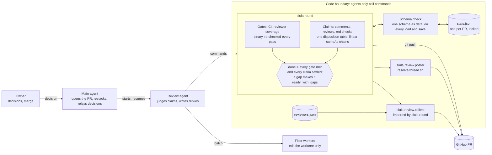

# Review loop design record

This file records why the review loop (`siula round`) works as it does. Read it before you change the engine, so a later edit does not undo a decision that evidence settled. The `siula-shepherd` agent skill tells the agent what to do. The modules `src/siula/review/round.py` (`siula round`) and `src/siula/review/collect.py` (`python -m siula.review.collect`) describe their own commands and output in their headers.

The engine was first built and run in a private repository, then moved to siula. A `#<n>` reference in this file, and in the docstrings of `tests/test_review_round.py`, names a PR of that private repository. Those PRs are not public, so each reference gives a short description and the date instead of a link. A "work monorepo PR" is a PR in the owner's employer's private monorepo.

## Architecture

The review loop is a reconcile loop. Each `siula round sync` call observes the whole PR, compares it with the state of what the loop already handled, and returns only the difference and one `next` action. The agent acts on `next` and calls `sync` again. Agents only call `siula round` commands. Code owns the state, the timers, and the stop conditions.

Inside `siula round`, two lanes decide `next`. **Gates** are binary conditions that `sync` re-checks on every pass: CI (the required checks, or every check when none is required, and every check suite with check runs completed; with none required, every check run on the head must also pass) and reviewer coverage. **Claims** are judgments: comments, reviews, and one attribution claim per red check on each head. Every claim goes through one disposition table, and `sameAs` links each claim's entries in one linear chain. Every inbox item is cited by a claim or listed as noise with a reason. `done` means every gate is met and every claim is settled. `done` sets the target `ready_for_human_merge` only when `sync` reports no gap. With a gap (a reviewer that timed out, no reviewer configured, or no CI checks on the head), it sets `ready_with_gaps`, and the controller never merges that PR.



The schema check is a runtime check like zod or pydantic, written with the standard library. siula already depends on pydantic, so a later change can replace the checker with a pydantic model; the schema stays one declaration either way. `reviewers.json` names one reviewer per repository and feeds the collector's coverage check (see [Reviewers config](#reviewers-config)).

Evidence for the coverage rule, confirmed on #159 (a private PR, 2026-10-14): Codex adds a 👍 on every clean head, and posts a review without a 👍 when it has findings.

## Who owns what

| Owner | Owns | Never does |
| --- | --- | --- |
| The owner (the person the agent acts for) | Design decisions, the merge | — |
| Main agent | Opening the PR, restacks, passing the owner's decision to `resume` | Review fixes |
| Review agent | Validity, design or edges class, disposition, reply text | Writes the state file, merges, dismisses a human review, force-pushes |
| Fixer workers | Edits in the isolated worktree, focused checks | Commits, pushes, posts, resolves |
| `siula round` | The state file, head times, the handled set, posts, pushes, `next` | Judges a claim |
| `siula.review.collect` | One read of the PR and the reviewer state; the shared login and time rules | Writes anything |

## Invariants

**Model: conditions are gates; judgments are claims.** CI and reviewer coverage are gates that `sync` re-checks on every pass; only green CI clears the CI gate. Comments, reviews, and failing checks are claims. Each red check on a head becomes one attribution claim, `check:<head>:<name>`, triaged once through the same table as any comment: caused by this PR is `Fix`, not caused is `No change`, and a choice for the author is `Needs decision`. A settled check claim never clears the CI gate; `Follow-up` or `Already addressed` on a check claim also leaves the gate red. An item with no claim is listed as noise with a one-line reason, and goes into the ledger with the disposition `Noise`. A red check is never noise.

Each invariant is enforced in code and has a black-box test in `tests/test_review_round.py`.

| ID | Invariant | Test |
| --- | --- | --- |
| S1 | Only `siula round` writes `state.json`, under the lock, with an atomic replace. When the file cannot be read, has an unknown version (a version-2 file is refused, not migrated), or does not fit the one declared schema (`STATE_SCHEMA`, checked by `load` and `save`), every command refuses and writes nothing. The schema includes the rules between the learning signals: a noise entry has no proposal; a `proposal` names a stored proposal of a `Needs decision` entry, and every `Needs decision` entry names one; a proposal has 2 to 4 options A, B, ... in order and recommends one of them; every ledger source has an archived item in `items`; and an archived item sits under its own key. | `test_S1_a_writer_is_refused_while_the_lock_is_held`, `test_S1_writes_leave_no_temp_file`, `test_S1_unreadable_state_is_never_overwritten`, `test_S1_a_wrong_type_in_any_state_field_is_refused_without_a_traceback`, `test_S1_the_full_state_fixture_loads`, `test_S1_an_unknown_value_in_the_state_file_is_refused`, `test_S1_a_broken_learning_signal_in_the_state_file_is_refused`, `test_S1_a_version_2_state_is_refused_by_every_command`, `test_S1_state_is_kept_per_owner_repo_and_pr`, `test_S1_a_dot_component_in_the_repository_is_a_usage_error` |
| S2 | Feedback enters the inbox only through `sync`, from an observed PR state, and becomes handled only through `triage`. Sent is not handled: `sync` returns the inbox again until a triage. GitHub keeps a comment's ID when someone edits it, so a comment that the run holds (archived by triage, or waiting in the inbox) comes back as a revision item `<key>@<n>` when its body differs from the latest text held for it. The earlier item stays, and triage covers the revision like any inbox key. An unchanged body, the run's own comment, a check, and a finding get no revision. A triage covers every inbox key: a claim cites it (a reopened `ledger:L<n>` item by `sameAs: L<n>`), or one noise entry names it with a reason. A check key is never noise. An uncovered key, a key that is both noise and cited, or a bad noise entry refuses the whole batch. In the same write, triage archives each covered item, except a reopened decision, in `items` under its key, with the body cut to 8,000 characters, so each revision has its own entry and the first never changes. In reviewer mode this includes each `finding:<n>` item that `findings` added. A claim cites only inbox keys and archived items; the run's own comments are refused as sources. A batch with a `Needs decision` entry carries exactly one proposal, which each such entry names, and a batch without one carries none. A bad proposal, or a claim entry with an unknown field such as the dropped `grade` or `evidence`, refuses the whole batch. | `test_S2_triage_and_post_refuse_ids_that_sync_never_returned`, `test_S2_triage_refuses_the_runs_own_comment_as_a_source`, `test_S2_own_reply_is_handled_and_rounds_keep_counting`, `test_S2_returned_items_stay_in_the_inbox_until_triage`, `test_S2_a_triage_that_leaves_an_inbox_key_uncovered_is_refused`, `test_S2_triage_refuses_an_invalid_noise_entry`, `test_S2_a_red_check_is_never_noise`, `test_S2_noise_is_a_ledger_entry_and_its_key_becomes_handled`, `test_S2_a_reopened_decision_is_covered_only_by_a_claim_with_its_sameAs`, `test_S2_triage_archives_each_covered_item_by_key`, `test_S2_a_long_body_is_archived_cut_to_8000_characters`, `test_S2_an_edited_comment_returns_to_triage_as_a_revision`, `test_S2_a_comment_edited_while_its_item_waits_in_the_inbox_is_triaged_in_both_texts`, `test_S2_codexs_edited_status_comment_is_a_revision_that_noise_settles`, `test_S2_an_edit_to_the_runs_own_comment_adds_no_revision`, `test_S2_a_long_body_is_compared_in_full_not_by_its_archived_cut`, `test_S2_an_archive_from_before_body_hashes_still_loads_and_compares_its_text`, `test_S2_reviewer_mode_triage_archives_a_cited_finding_and_the_state_loads_again`, `test_triage_refuses_a_claim_that_still_sends_grade_and_evidence`, `test_S2_triage_refuses_an_invalid_proposal`, `test_S2_a_proposal_is_paired_with_the_answer_to_its_decision_stop` |
| S3 | Each head's time is written once, by `push` or `sync`, and never overwritten. | `test_S3_a_pushed_head_keeps_its_push_record_through_later_syncs`, `test_S3_a_force_pushed_head_gets_its_own_first_seen_time` |
| S4 | A `pending` post is reconciled before any other command acts. `resume` keeps it, and the next `sync` looks for the post on GitHub and records it as posted or not posted. A reconciled thread post records the same reply receipts as `post`. | `test_S4_a_pending_post_stops_every_writer`, `test_S4_resume_reconciles_an_unknown_post_with_github`, `test_S4_a_reconciled_thread_post_records_a_reply_receipt` |
| S5 | Only `resume` with a non-empty `--decision` moves the status out of `needs_input` or `blocked`. It writes the decision as the answer of the one open stop, in the same write, and never into an older stop. The answer decides only the ledger entries that its stop listed in `entries`. A stop without `entries`, from an older state, decides nothing, so its claims are asked again. | `test_S5_only_resume_with_a_decision_leaves_needs_input`, `test_S5_an_answer_to_another_stop_decides_no_claim`, `test_S5_an_answer_decides_only_the_ledger_entries_its_stop_listed`, `test_S5_a_decision_stop_without_entries_decides_nothing_and_asks_again`, `test_S5_a_resume_answers_only_the_open_stop`, `test_S5_a_resume_with_no_open_stop_is_refused` |
| S6 | `siula round push` pushes only a fast-forward of the round's head, never with force, and refuses when the remote moved. It pushes only to the PR's repository: origin's URL and each push URL (`remote.origin.pushurl`), as configured, must name `<owner/repo>`. | `test_push_refuses_unless_it_fast_forwards_the_rounds_head`, `test_push_refuses_a_dirty_worktree`, `test_post_and_push_refuse_a_checkout_of_another_repository`, `test_S6_push_refuses_a_push_url_that_names_another_repository`, `test_S6_push_goes_ahead_when_each_push_url_names_the_prs_repository` |
| S7 | `post --resolve` resolves only a thread that a bot or the PR author opened. A deleted account or any other starter is skipped. | `test_post_resolve_leaves_another_humans_thread_open` |
| T1 | `done` only when every gate is met and every claim is settled, on the current head. Gates: green CI, and reviewer coverage or a reported timeout (after a re-trigger, or after 1200 s when no re-trigger is configured). CI is green only when every listed check passes and every check suite on the head that has check runs has completed; a suite list that cannot be read in full is pending. With no required checks, every check run on the head in REST must also pass, because `gh pr checks` can leave a run out: a run that has not completed is pending, a completed run that did not pass is failing, and a run list that cannot be read in full is pending. Claims: an empty inbox (an edit to a comment that the run holds puts its revision there), no latest `Fix` without a push receipt from `siula round push` and a reply receipt for each thread it cites (a cited revision `thread:<id>@<n>` asks for the reply on `thread:<id>`; a head move by anyone else settles nothing), no claim whose latest disposition (following `sameAs`) is still `Needs decision`, and no blocking review. `done` sets `ready_with_gaps` when `sync` reports a gap, and `ready_for_human_merge` otherwise. A claim's decision counts only from the answer of a `decision_owed` or `blocking_review` stop that listed its ledger entry in `entries`; a new claim that cites the same comment is asked again. `resume` then returns the claim to the inbox, so the agent applies the decision. With no required checks, every check on the head counts. A missing reviewers file means no reviewer is configured, which allows `done` with a gap. | `test_T1_done_only_when_every_condition_holds`, `test_T1_without_required_checks_every_check_on_the_head_counts`, `test_T1_an_unconfigured_reviewer_allows_done_with_a_gap`, `test_T1_a_decided_claim_is_triaged_again_before_done`, `test_T1_changes_made_while_paused_are_picked_up_after_resume`, `test_T1_a_red_check_waiting_on_a_decision_can_be_decided`, `test_T1_a_red_check_triaged_no_change_waits_for_ci`, `test_T1_a_red_check_triaged_fix_is_pushed`, `test_T1_a_new_failure_on_a_new_head_enters_the_inbox_again`, `test_T1_an_old_heads_red_check_is_not_taken_in_when_the_head_moves`, `test_T1_no_checks_needs_positive_evidence_from_rest`, `test_T1_a_fix_superseded_by_no_change_does_not_block_done`, `test_T1_a_covered_head_with_green_ci_is_ready_for_human_merge`, `test_T1_a_codex_review_receipt_covers_only_the_head_it_names`, `test_T1_a_new_run_clears_the_gaps_and_the_target`, `test_T1_ci_is_not_green_while_a_check_suite_with_runs_is_still_running`, `test_T1_unreadable_check_suites_are_never_green`, `test_T1_an_unlisted_failing_check_run_is_never_green_without_required_checks`, `test_T1_an_unlisted_running_check_run_keeps_ci_pending_without_required_checks`, `test_T1_unlisted_runs_that_pass_or_belong_to_a_bot_review_leave_ci_green`, `test_T1_unreadable_check_runs_are_never_green_without_required_checks`, `test_T1_a_fix_is_not_settled_when_another_actor_moves_the_head`, `test_T1_a_pushed_fix_waits_for_a_reply_to_each_thread_it_cites`, `test_D3_a_fix_that_cites_a_thread_revision_waits_for_a_reply_on_its_thread`, `test_S2_an_edited_comment_returns_to_triage_as_a_revision`, `test_a_missing_reviewers_file_means_no_reviewer_is_configured` |
| T2 | Never `done` on silence alone. A head with no checks counts as green only 120 s after its head time, and only when no earlier head of the PR had checks. Check runs that a bot review adds are not CI. The closed list `BOT_REVIEW_CHECKS` names them; it now holds `copilot-pull-request-reviewer`. Such a run holds only its own head while it runs, and it never makes a later head wait. A `done` after a reviewer timeout, with no reviewer configured, or on a head with no checks sets `ready_with_gaps`, never `ready_for_human_merge`. | `test_T2_silence_waits_then_retriggers_then_times_out_with_a_gap`, `test_T2_no_checks_just_after_a_push_is_not_green`, `test_T2_a_bot_review_check_on_an_earlier_head_does_not_hold_a_head_without_checks`, `test_T2_a_bot_review_check_holds_only_its_own_head_while_it_runs`, `test_sync_handles_a_head_without_checks` |
| T3 | `needs_input` on a design verdict, an unknown post, or an owed decision; `blocked` at `--max-rounds`. Each has a `resumeCondition`. | `test_T3_an_unknown_post_result_needs_input`, `test_T3_a_design_verdict_lets_the_round_post_then_needs_input`, `test_T3_max_rounds_blocks_until_resume_raises_the_cap` |
| T4 | Every repeated `next` is bounded. When the same head returns the same unresolved `next` for the same reason with no new input, `sync` returns `needs_input` that names the repeat: an unpushed Fix, a pushed Fix without a reply, a decision not applied, a due re-trigger not posted, or CI not green for 30 minutes. New input (a new inbox item or a new head) resets the count. | `test_T4_a_fix_that_is_never_pushed_stops_the_run`, `test_T4_a_pushed_fix_that_is_never_replied_to_stops_the_run`, `test_T4_ci_pending_for_30_minutes_stops_the_run`, `test_T1_unreadable_check_suites_are_never_green`, `test_T1_unreadable_check_runs_are_never_green_without_required_checks` |
| R1 | Reviewer mode never changes the PR branch or another person's thread. `push` and `post` (thread reply, `--resolve`, `--issue`) refuse. The only GitHub write is `review`. | `test_R1_reviewer_mode_replies_to_no_thread_and_pushes_no_branch` |
| R2 | The mode matches authorship, with positive evidence. `sync` compares the PR author with `gh api user`. It refuses author mode on another person's PR, reviewer mode on your own PR, and an unreadable login. A state keeps its mode. | `test_R2_author_mode_is_refused_on_another_persons_pr`, `test_R2_reviewer_mode_is_refused_on_the_viewers_own_pr`, `test_R2_an_unreadable_viewer_login_is_refused`, `test_R2_an_unreadable_pr_author_is_refused`, `test_R2_a_state_cannot_change_its_mode` |
| R3 | A review is pinned to the synced head with `commit_id`, carries the `agent on behalf of` footer, and is posted once per head and viewer. It reads every review page. An unknown result goes through S4. | `test_R3_a_review_is_posted_on_the_synced_head_with_the_agent_footer`, `test_R3_a_review_is_refused_when_the_head_moved_after_the_last_sync`, `test_R3_a_head_gets_one_review_from_the_viewer`, `test_R3_the_viewers_review_on_a_later_page_still_blocks_a_second_review`, `test_R3_S4_an_unknown_review_result_needs_input_and_resume_reconciles_it` |
| R4 | `APPROVE` needs green CI, an empty inbox, no latest `Needs decision`, and no latest `Fix` with severity `blocker` or `high`. The refusal names each blocker. `APPROVE` also refuses a removed test file, a renamed test file, and a changed file with more test markers (`skip`, `only`, `xfail`) at the head than at the merge base. It refuses when the file list is short or unreadable. The test-file and marker rules are `is_test_file` and `MARKER` from `siula.review.test_integrity`, imported, so they always load. The live head is read again after the CI read, and a moved head refuses. Medium and low `Fix` do not block. | `test_R4_approve_is_refused_until_every_condition_holds`, `test_R4_approve_is_refused_when_the_head_moves_during_the_ci_read`, `test_R4_a_medium_or_low_fix_does_not_block_approval`, `test_R4_approval_follows_the_sameAs_chain_to_the_latest_claim`, and the `test_R4_a_..._refuses_approval` tests for removed, renamed, and marker changes |

**Guardrails are prose.** Never merge, never dismiss a human review, and never force-push are rules in the agent skill's prose. No code enforces them; a guard hook is deferred (see Deferred and Decisions).

## Command reference

Every command takes `<owner/repo> <pr>` and prints one JSON object on stdout.

| Command | Options | Effect |
| --- | --- | --- |
| `siula round sync <owner/repo> <pr>` | `[--mode author\|reviewer] [--max-rounds N] [--settle N] [--interval N] [--ceiling N]` | Observe the PR, update the inbox, and print `next`. |
| `siula round triage <owner/repo> <pr>` | `--file F` | Record a batch of claim, noise, and proposal entries. |
| `siula round findings <owner/repo> <pr>` | `--file F` | Reviewer mode: add your own findings to the inbox. |
| `siula round review <owner/repo> <pr>` | `--event APPROVE\|COMMENT\|REQUEST_CHANGES --body-file F` | Reviewer mode: post the one review of the head. |
| `siula round post <owner/repo> <pr>` | `(--thread COMMENT_ID \| --issue) --body-file F [--resolve]` | Post a signed reply to a review thread, or a signed PR comment. |
| `siula round push <owner/repo> <pr>` | none | Push the worktree's HEAD to the PR branch as a fast-forward. |
| `siula round pause <owner/repo> <pr>` | `--reason TEXT` | Stop a running run with a `pause` stop. |
| `siula round resume <owner/repo> <pr>` | `--decision TEXT [--by NAME] [--max-rounds N]` | Answer the open stop. `--by` defaults to `owner`. |
| `siula round show <owner/repo> <pr>` | none | Print the state file. |

Exit codes: 0 on success. 1 on a refusal or a tool error, with one `ERROR: ...` line on stderr and nothing on stdout. The one exception is a post whose thread did not resolve: it also prints its result on stdout. 2 on a usage error, such as a bad option, a repository that is not `<owner/repo>`, or an empty `--body-file`; nothing runs.

`siula round` imports the collector. You can also run it alone, as `python -m siula.review.collect <owner/repo> <pr-number> [options]`; its module header lists its options and output.

**State.** `~/.local/state/siula/review/<owner>/<repo>/<pr>/state.json` holds the status, `round`, `maxRounds`, `heads{sha: {firstSeen, source}}`, the `inbox`, the `handled` keys, the `ledger`, the `stops`, `pending`, the T4 tracking (`last`), `target`, `gaps`, and the learning signals `items` and `proposals`. `skillSha` records the git commit of the engine's package directory, or `unknown` outside a git checkout. `done` sets `target` (`ready_for_human_merge` or `ready_with_gaps`) and `gaps` (the gap texts of that `done`, free text that code never reads); a new run clears both. Each ledger entry holds `pushed` (the head that `siula round push` sent a `Fix` in, or null) and `replies` (`thread:<id>` to the reply's comment ID, or null). A `Needs decision` entry names its batch's proposal in `proposal`; every other entry, including a noise entry, has null there. `items` maps each key that a triage covered to the item as `sync` returned it (or, in reviewer mode, as `findings` added it), with `truncated` true when its body was cut to 8,000 characters, and `bodySha256`, the hash of the whole body, which `sync` compares to find an edit. An item from before `bodySha256` existed loads without it, and `sync` compares its stored text instead, cut the same way when `truncated` is true; a reopened decision is never archived, and an archived item is never overwritten. `proposals` maps `P<n>` to `{round, summary, options: {A: text, ...}, recommended, at}`; the summary and the options are free text that code never reads. Both are kept for the life of the file (see Deferred). The state version is 3. Every command refuses a version-2 file, because it has no `items` or `proposals`. Rename it to move it aside, for example to `state.v2.json` in the same directory; the next `sync` then starts a new state and returns every comment of the PR again. Every command refuses a state file whose stored repository or PR differs from its own. Each move into `needs_input` or `blocked` opens a stop `stop-<n>` with its `condition` (a closed list: `decision_owed`, `blocking_review`, `unknown_post`, `misrouted_post`, `max_rounds`, `repeat`, `fix_returned`, `pause`), an optional free-text `detail`, the keys of the undecided claims open at that moment (`claims`), the IDs of their ledger entries (`entries`), and a null `answer`. A stop with no undecided claim has no `entries`. Stops written before `entries` existed load without it and decide no claim, so `sync` asks an open decision again. At most one stop is open at a time, and its condition is the `resumeCondition`. Keys are `thread:<id>`, `review:<id>`, `issue:<id>`, or `ledger:<id>`, because the REST ID spaces are separate. A comment's revision key is `<key>@<n>`, where `n` (2 or more) counts its texts; the comment's own key is its first text. `REVIEW_PR_NOW` overrides the clock of `siula round` in tests, and `REVIEW_PR_CLOCK` names the file that holds the collector's test clock, which the collector's waits advance.

**`sync`.** Every `gh` call names `<owner/repo>`, so the working directory does not matter. Without state, it creates it for an open PR from the same repository; `--max-rounds` (default 8) applies only then. After `succeeded`, it starts a new run that keeps the rounds, heads, handled keys, ledger, and decisions. On `needs_input`, `blocked`, or an unresumed `pending` post, it observes nothing and prints `{next, resumeCondition}`. After `resume`, it first reconciles `pending`: it looks for a comment by the PR author at or after `pending.at` whose body hash matches, in the target's thread or in the issue comments, takes the earliest match, and reports `reconciled`. Then it records a new head as `seen`, reads the [reviewers config](#reviewers-config), calls the collector in arrival mode (`--settle 20`, `--interval 30`, `--ceiling 300`), reads CI, and adds unhandled feedback to the inbox. For each comment that the run holds, it compares the observed body's hash with the latest held text (`bodySha256`); a different body adds `<key>@<n+1>` after the latest revision `n`. The collector does not count an edit as new feedback, so an edit alone does not end its wait early. Each red check on the head enters the inbox once as a check claim, unless the head moved during the call. `round` grows by 1 when the inbox gets new items; at `maxRounds` the run is `blocked` and the new batch stays out of the inbox.

Output: `{head, headChanged, round, newItems, ci, reviewer, gaps, reason, next}`, plus `resumeCondition`, `reconciled`, and `target` (on `done`) when they apply.

- `newItems`: the whole inbox. Each item has `key`, `kind`, `id`, `author`, `body` (without the poster's footer), `bodySha256`, `createdAt`, and the thread or review fields. A revision item also has `revises`, the key of the text it follows, and keeps the comment's `id`. A check claim has `kind: check` and its check name. A reopened claim has `kind: decision` with its `claim`, `sources`, `decision`, and `proposal` (a copy of the proposal that its ledger entry names, or null).
- `ci`: `{state: green|pending|failing|none, failing, reason}`. Required checks count; with none required, every check on the head counts. A check that a bot review adds (`BOT_REVIEW_CHECKS`) is not CI, so `sync` removes it from these lists. "No checks" needs positive evidence from REST. `sync` reads the names of the head's check runs (`commits/<sha>/check-runs`, 100 per page) and the count of its commit statuses. Any other check run, a run that REST counts but does not list, or a commit status makes CI `pending` with the reason `checks exist but were not listed`. A bot-review run that has not completed makes CI `pending` with the reason `bot review still running: <names>`. With no other run, CI is `none`. If a read fails, or the check-run response has no `total_count` or no `check_runs` list, `sync` stops. When every listed check passes, `sync` also reads the head's check suites (`commits/<sha>/check-suites`, 100 per page). A suite with at least one check run that has not completed makes CI `pending` with the reason `check suites still running: <app slugs>`. A suite with no check runs does not count, because idle apps keep one queued forever. A failed call, invalid JSON, a wrong shape, or a `total_count` above the listed suites makes CI `pending` with the reason `the check suites of <sha7> could not be read`; T4 bounds that wait. With no required checks, when every suite has completed, `sync` also reads the head's check runs (`commits/<sha>/check-runs`, 100 per page), because `gh pr checks` can leave a run out, such as a `workflow_dispatch` run. It skips `BOT_REVIEW_CHECKS`. A run that has not completed makes CI `pending` with the reason `check runs still running: <names>`. A completed run whose conclusion is not `success`, `neutral`, or `skipped` makes CI `failing` with its name in `failing`, so it enters the inbox as a check claim. A failed call, invalid JSON, a wrong shape, or a `total_count` above the listed runs makes CI `pending` with the reason `the check runs of <sha7> could not be read`; T4 bounds that wait. With required checks, `sync` does not read the check runs. Known cost: a suite also holds jobs that are not required, so `done` waits for the whole workflow, and T4 stops a wait of more than 30 minutes.
- `reviewer`: the collector's object, or `null` when the head moved during the call.
- `headChanged`: true only when the head moved during this call, between the first read and the collector snapshot or the CI read. A head that moved between two calls is recorded as a new head, with `headChanged` false.
- `gaps`: `<login> did not review <sha7>`, `no reviewer configured for <repo>`, `no CI checks on <sha7>`.

`next` is the first rule that applies:

1. `triage`: the inbox is not empty.
2. `needs_input`: a decision is owed (`decision owed on L<n>`) or a blocking review stands.
3. `triage`: a decided claim is still `Needs decision`.
4. `triage`: a latest `Fix` has no push receipt (`unpushed fix L<n>`), or a thread that it cites has no reply receipt (`unreplied fix L<n>`). The head does not matter: only `siula round push` and `siula round post` settle a `Fix`.
5. `retrigger`: the re-trigger is due.
6. `wait_reviewer`: the reviewer has not covered the head or timed out, or the head moved.
7. `wait_ci`: CI is pending or red.
8. `done`: sets `succeeded`, stores `gaps`, and sets the target `ready_with_gaps` when `gaps` is not empty, else `ready_for_human_merge`.

**`triage`.** Writes all entries or none. An entry is a claim entry, or a noise entry `{"noise": "<key>", "reason": "<one line>"}`. A noise key must be a `thread:`, `review:`, or `issue:` key in the inbox; a check or a reopened decision is never noise. Every inbox key must be a source of a claim entry or the key of exactly one noise entry, never both; an inbox `ledger:L<n>` item is covered by a claim entry with `sameAs: L<n>`. The refusal names each uncovered key, and `[]` is valid only for an empty inbox. A noise entry is stored as a ledger entry with its reason as `claim`, `class` null, the disposition `Noise` (which asks for no response), its key as the one source, and `sameAs` null; a claim entry may not use `Noise`. In the same write, every inbox key becomes handled. Sources must be inbox keys or keys in `items`. A key that `sync` never returned is refused. The run's own comment is refused too: `post` marks it handled, but `sync` never returns it, so it has no archived item. To apply a decision, triage the claim again with `sameAs` set to its ledger ID. `sameAs` must name the latest entry of its claim, and one batch may continue a claim only once, so each claim is one linear chain whose tail is its latest entry; `load` refuses a stored ledger that branches.

A claim entry has only the fields `claim`, `class`, `disposition`, `sources`, `sameAs`, and `severity`; any other field, such as the dropped `grade` or `evidence`, is refused by name. A batch with a `Needs decision` claim entry holds exactly one proposal element, `{"proposal": {"summary", "options", "recommended"}}`, and a batch without one holds none. The summary has at most 2,000 characters, the 2 to 4 options are one line of at most 200 characters each, and `recommended` is the letter of one option. The element covers no inbox key. Each refusal names the field and its allowed values, and records nothing. In the same write as the ledger entries, `triage` stores the proposal as `P<n>`, with the options lettered A, B, ... in order, and each `Needs decision` entry of the batch names it. It also archives each covered item that is not a reopened decision in `items`.

**`post`.** Posts through `siula.review.poster` in the same process. It first checks that the working directory is a checkout of `<owner/repo>`. Then it builds the poster's REST path; an input that the poster refuses, such as a repository name that GitHub cannot have, stops the command with `cannot post to <repo>#<pr>: ...; nothing was posted`, and nothing is recorded. Next it writes `pending` (`{kind, target, at, bodySha256}`, never the body), reads the viewer's handle, signs the body with the `agent on behalf of <handle>` footer, and posts it. Any GitHub error, or a response without an integer comment ID, makes the result unknown: the response that `gh` printed goes to stderr, and the run stops with `unknown_post`. A response whose URLs point to another repository or PR stops the run with `misrouted_post`, and no receipt is recorded. `--issue` also works after `succeeded`, for a final summary. After a `--thread <id>` post, every ledger entry that cites `thread:<id>` or a revision of it (`thread:<id>@<n>`) records the reply's ID in `replies` under `thread:<id>`, except a `Fix` without a push receipt: a reply before the push does not count. The S4 reconcile of a thread post records the same receipts. `--resolve` runs `resolve-thread.sh`, which ships as package data, with `bash`.

**`push`.** Pushes local HEAD to the PR branch without force, only when the worktree is clean, origin is at the round's head, and HEAD descends from it. First it reads origin's URL and every push URL as configured (`git config`, so an `insteadOf` rewrite does not hide the name). Each must name `<owner/repo>`, compared without case, because `git push origin` sends to every push URL when one is set. Otherwise it refuses before any fetch or push and records nothing; with no push URL set, only the URL counts. Known limit: the check does not resolve rewrites, so an `insteadOf` or `pushInsteadOf` rule in the Git config can still send the push to another repository. It records the new head as `pushed`. It also writes the new head into the `pushed` receipt of each latest `Fix` entry that has none and was triaged on the round's head.

**`resume`.** Writes the decision as the `answer` of the open stop and sets `running` in one write. It never writes an older stop, and it refuses when no stop is open. A claim is decided only when a stop lists its ledger entry in `entries`, that stop has an answer, and the stop's condition is `decision_owed` or `blocking_review`; those claims return to the inbox. An answer to an unknown post, the round cap, a repeat, or a pause decides no claim. Each reopened claim also carries `proposal`, a copy of the proposal that its ledger entry names, or null. `--decision` stays the owner's words verbatim, and code never parses them; when the owner picks an option, the words name its letter. `resume` keeps `pending` for `sync` to reconcile, and clears the T4 tracking.

**Reviewer mode.** `sync --mode author|reviewer` (default `author`) sets the mode when the state is created. The mode is stored in `mode`. An existing state keeps its mode, and a different `--mode` is refused. `sync` refuses a mode that does not match the PR author (R2), before any state write.

- `findings <owner/repo> <pr> --file F`: reviewer mode, current head. `F` is a JSON list of `{severity: blocker|high|medium|low, file, line (int or null), body}`. Each entry becomes an inbox item with key `finding:<n>`. Numbers continue and are never reused. A `finding:` key may be noise.
- Triage claims carry `severity` (`blocker`, `high`, `medium`, `low`, or null). In reviewer mode, `Fix` and `Needs decision` need a severity. `Fix` means the author should change the code; `siula round` pushes nothing.
- `review <owner/repo> <pr> --event APPROVE|COMMENT|REQUEST_CHANGES --body-file F`: refuses when the live head differs from the last synced head, or when the viewer already reviewed that head. It signs the body with the poster's footer (`---` and `agent on behalf of <viewer>`) and posts with `commit_id`. `APPROVE` applies R4. It records `review: {id, event, head}`, and the key `review:<id>` joins `handled`.
- `next` in reviewer mode: `triage`, `needs_input`, `wait_reviewer`, `wait_ci`, `review`, `done`. `review` means the review is due. `done` sets the target `reviewed` after a review exists on the current head. A standing `CHANGES_REQUESTED` review by the viewer does not block `next`.
- No re-trigger: the reviewer entry has no `retrigger`, so the 1200 s timeout applies and a missing bot review becomes a gap.

## Reviewers config

`sync` reads the reviewer of the PR's repository from `$XDG_CONFIG_HOME/siula/reviewers.json` when `XDG_CONFIG_HOME` is set to an absolute path, and from `~/.config/siula/reviewers.json` otherwise. A relative `XDG_CONFIG_HOME` is ignored. siula ships no reviewers file.

- A missing file means that no reviewer is configured. `reviewer.state` is `unconfigured`, and `done` reports the gap `no reviewer configured for <repo>`, so the target is `ready_with_gaps`.
- A file that exists but cannot be read or parsed, or a bad entry for the PR's repository, stops `sync` with `the collector failed: --reviewers file ...` before the round, the inbox, or the handled keys change.
- Keys are `<owner/repo>`, matched without case. Each entry has only `login` (required), `retrigger` (the comment text that asks for a new review), and `doneReaction` (one of `+1 -1 laugh hooray confused heart rocket eyes`). Only the entry for the PR's repository is checked.

Example:

```json
{
  "octo-org/hello-world": {
    "login": "chatgpt-codex-connector[bot]",
    "doneReaction": "+1",
    "retrigger": "@codex review"
  },
  "octo-org/monorepo": {
    "login": "claude[bot]",
    "retrigger": "@claude review"
  }
}
```

## Before you merge a change to the review loop

Unit tests use a fake `gh`, so they cannot catch a wrong assumption about real GitHub or `gh` behaviour. Two such defects (a post to the wrong repository, and a crash on a head with no checks) passed every test and failed the live smoke. Run this smoke on a private sandbox repository that you own before each merge that changes `siula round`, the collector, the poster, or the reviewers config.

- Work in a fresh clone of the sandbox, never in a siula worktree. Install siula from your branch, and point `XDG_CONFIG_HOME` at a scratch directory that holds a test `siula/reviewers.json`.
- **Silent bot:** a reviewer login that never answers. Expect `retrigger` after 600 s, one re-trigger comment, then `done` 600 s later with the gap "`<login>` did not review `<sha7>`".
- **No checks:** on a head with no checks, `sync` returns "no checks yet" for the first 120 s, then the gap "no CI checks on `<sha7>`". It never fails.
- **Restart with the inbox:** add a comment and run `sync`, then `sync` again from a new process before `triage`. The same item comes back, and no comment appears twice.
- **Pause and resume:** while paused, `sync` does not observe and `post` refuses. A push and a comment made while paused are picked up after `resume`.
- **Push and force-push:** `siula round push` records `pushed`, and a later `sync` keeps it. A force-pushed head gets its own `seen` time.
- **Wrong working directory:** run `post` from a clone of another repository. It must refuse and post nothing.
- **Receipt check:** every posted comment's URL in the `post` output points to the sandbox PR.
- **Target with gaps:** the silent-bot `done` reports `target: ready_with_gaps` in the `sync` output and in `siula round show`.
- **Running check suite:** start a run that `gh pr checks` does not list, such as a `workflow_dispatch` run on the PR head (gh 2.102.0 omits those). While its github-actions suite is `in_progress`, `sync` returns `wait_ci` with "check suites still running: github-actions", although every listed check passes. A running `pull_request` job is listed as pending, so it never reaches the suite read. An idle app's queued suite with no runs does not block `done`.
- **Failed unlisted run:** with no required checks, let that `workflow_dispatch` run fail. `sync` returns `triage` with the run's name in `ci.failing`, never `done`.
- **Cite or noise:** `triage` with `[]` while the inbox holds items is refused and names the keys.
- **Edited comment:** after a triage, edit a reviewer's comment to add a line. `sync` returns `<key>@2` and `triage`, never `done`, and `siula round show` keeps both texts in `items`.
- **Fix receipts:** after a `Fix` is triaged, push a commit with a plain `git push`. `sync` returns `triage` with `unpushed fix L<n>`, never `done`.
- **Learning signals:** triage one design batch with a proposal. `siula round show` lists each covered comment under `items` with its text as GitHub shows it, without the poster's footer; and the proposal under `proposals`. Resume with `--decision "B, <words>"`: the stop's answer keeps the words as they are, and the next `sync` returns each reopened claim with the proposal.
- **Reviewer mode review:** on a sandbox PR authored by another account, run `sync --mode reviewer`, then `review --event COMMENT`. The review shows `commit_id` equal to the head and the `agent on behalf of` footer.
- **Review state mapping:** read the review back through the REST API. Check that each event (`APPROVE`, `COMMENT`, `REQUEST_CHANGES`) maps to the state that the reconcile step expects.
- **Paginated reviews:** on a PR with more than 30 reviews, check that the duplicate check and the reconcile step find the viewer's review on a later page.
- **Reviewer timeout:** with a silent bot, reviewer mode posts no re-trigger. After 1200 s the gap names the bot and `done` follows.
- **Author mode on another account's PR:** `sync` without `--mode` refuses and writes no state.

Record each result, with evidence, in the PR description.

## Decisions

| Decision | Rejected alternative | Evidence |
| --- | --- | --- |
| The loop records each head's time: `pushed` by `siula round push`, or `seen` by `sync`. | Infer the time from check suites, PR events, or commit dates. | Each inference had a new hole (open, reopen, force-push, fast-forward) in rounds 3–7 of #152, a private PR whose runs failed on 2026-10-09/10; the round 7 review comment recorded the last hole. Codex's 👀 came 16 s after a push, before a late seen time. |
| No busy signals. Re-trigger after 10 minutes without coverage; time out 10 minutes after the re-trigger. | Busy kinds (`status:`, `check:`, an 👀 reaction) and a 5-minute re-trigger. | Codex reviewed `a0a5acc` 13 minutes after the push, and #150 (a private PR, 2026-10-09/10) took 8.3 minutes. The busy vocabulary fitted the evidence of one week too closely (round 7). |
| One JSON state file per PR, replaced whole. | An event log or journal. | One user and one machine. Four of the five failures of 2026-10-09/10 lost state, and one was a stopped run that nobody restarted. None needed the history of past steps. |
| The engine uses only the Python standard library and siula's own modules, on the Python that siula requires (3.12). | Third-party packages, and the macOS system Python 3.9. | First decided for Python 3.11 (the owner, 2026-10-20): the installer already required 3.11, and Python 3.9 reached end of life on 2025-10-31. siula requires 3.12. |
| Every item kind (comment, review, check) follows one model and one `disposition → response` table. Kind-specific code lives only in intake (how an item is observed) and effect (how a response is carried out). | A separate branch in `next` for each item kind or special case. | Round 3 on #159 (a private PR, 2026-10-14): a special case for red CI made a CI claim that waited on a decision impossible to decide (the owner, 2026-10-14). |
| A field that code reads is a closed list or a typed ID, declared once in `STATE_SCHEMA` and checked by one recursive checker on every load and write: type first, then contents. An unknown value fails closed. Only `answer.text`, `claim`, `detail`, a proposal's `summary` and options, and the readable fields of an inbox or archived item are free text, and code never reads their content. | Free-text conditions and reasons that code matches. | The owner, 2026-10-14, after the decision link matched decisions to claims by round. |
| A guard that lets the run continue (to `done`, a resolve, a push, or a decided claim) needs positive evidence about its own object; otherwise it stops with `needs_input`. | Treat missing or unreadable evidence as "nothing to block". | Codex's review of round 1 of #159 (a private PR, 2026-10-14) found six guards that accepted weak or missing evidence; its summary comment listed them. |
| The collector is Python (`siula.review.collect`), and `siula round` imports it. It owns the login comparison (`same_login`) and the time rule (`epoch`, `not_before`); `siula round` uses them. | Keep the collector in bash and jq, called as a subprocess. | Most collector defects before #159 (2026-10-14) were in jq: the time-offset regex, `[bot]` login normalization, and a field dropped at the ceiling. Two rules were duplicated in the round engine until the port. |
| `reviewers.json` holds only `login`, `retrigger`, and `doneReaction`. | A general signal vocabulary. | A review on the head or one done reaction covered every observed review. On #183 (a private PR, 2026-10-23), Codex posted only a receipt comment with `**Reviewed commit:**`, so a receipt from `login` that names the head is a third built-in signal, not a config key. |
| `done` with any gap sets the target `ready_with_gaps`; the controller merges only `ready_for_human_merge`. | `done` with gaps sets `ready_for_human_merge` and lists the gaps on the summary's Open line. | On #161 (a private PR), "Review complete (6428719)" was posted at 22:45:56Z, and Codex reviewed 6428719 at 22:47:08Z; its round 4 was design (the owner, 2026-10-18). |
| CI is green only when every check suite on the head that has at least one check run has completed, on top of the required-check read. | Trust `gh pr checks --required` alone; or wait for `mergeStateStatus` `CLEAN`. | #166 (a private PR): a work monorepo PR read green while `backend` had no run. On 2026-10-18, idle apps (cursor, claude, dbt-cloud, greptile) left suites `queued` with 0 runs, and another work monorepo PR had a github-actions suite `in_progress` with 18 runs. Live check, 2026-10-19T02:31Z: a third work monorepo PR listed 10 passing required checks without `backend` while its github-actions suite was `in_progress`; the old read was green, and the suite rule reads pending. The work monorepo requires one approval, so `mergeStateStatus` stays `BLOCKED` until a human approves (the owner, 2026-10-18). |
| With no required checks, CI is green only when every check run on the head in REST passes, on top of the `gh pr checks` read and the suite rule. A read that is not complete is pending. | Trust the suite rule: a completed suite means the runs are done. | Copilot's review of #4, 2026-10-23, found that a failed run that `gh pr checks` does not list, such as a `workflow_dispatch` run, sits in a completed suite, so the old read was green. |
| An edited comment that the run holds comes back as a new item, `<key>@<n>`, when the hash of its whole body (`bodySha256`) differs from the latest text held for it. Each text is archived under its own key. An edit while the item waits in the inbox adds a second item. The state version stays 3. | Refresh the waiting item or the archive entry in place; or detect edits by an edit time such as `lastEditedAt`, which the collector does not read. | Codex's review of #4, 2026-10-23, found that `sync` dropped every key that was handled or in the inbox, so a finding added by an edit never reached triage, and the run could reach `done`. A second item keeps the text that `sync` already showed the agent, so triage covers every text and no archive entry is overwritten. Codex edits its status comment on each review; triage lists that revision as noise. |
| A stop's answer decides only the ledger entries that the stop listed in `entries`. A stop from an older state has no `entries` and decides nothing, so its claims are asked again. The state version stays 3. | Match a stop's `claims` (source keys) against a claim's sources. | Copilot's review of #4, 2026-10-23, found that a new `Needs decision` claim that cites a decided comment was decided by the old answer and never asked. Asking an old decision once more is the safe failure. |
| A `Fix` settles only on a `siula round push` receipt and a `siula round post` reply receipt for each review thread it cites. | Settle a `Fix` when the head moves. | The round engine settled a `Fix` on any head move, so a head pushed by someone else settled a fix that was never pushed; the `reply` field was written but never read (the owner, 2026-10-18). |
| Every inbox key is cited by a claim (sources, or `sameAs` for a reopened decision) or listed as noise with a one-line reason. Noise goes into the ledger. A red check is never noise. | One `[]` acknowledges the whole inbox. | Any triage, even `[]`, marked every inbox key handled, so a code claim could be acknowledged with no ledger entry (the owner, 2026-10-18). |
| The merge, dismissal, and force-push rules stay prose, with no guard hook. | A PreToolUse hook that classifies shell text inside a run (#161, a private PR, closed without merge). | No run ever broke these rules: 60 PRs had 0 dismissals, 0 auto-merges, and only sanctioned restacks; on #154 (a private PR, 2026-10-09/10) the agent refused a force-push. #161 grew to 997 lines over 4 review rounds, mostly to keep the sanctioned merges open, and Claude Code documents Bash text matching as no security boundary (the owner, 2026-10-15). |
| Only a guard claim that can cause a false green or an unsafe action blocks as a Fix. A guard claim classified `edges` that fails safe settles in step 3c as `No change` and keeps its class; its reply names the bound that stops it. Check claims follow step 1, so a failing check that this PR caused is `Fix`. A fail-safe guard claim does not count toward the two-round design trigger. | Fix or decide every valid claim. | #166 (a private PR) ran rounds 2–5 on the CI read. Of seven claims, only L4 (a base change during sync) could cause a false green. L1, L9, and L11 were one "had checks" defect that only delayed `done`, and L3 and L5 became known limits (the owner, 2026-10-15). |
| `triage` archives each item it covers in `items`, by item key, in the write that marks the key handled. A reopened decision is not archived. | Copy the text into each ledger entry; keep only a hash and the URL; a separate signal log or a SQLite store. | A reviewer can edit or delete a comment, so GitHub is not a record of what the agent saw. Transcripts hold the text but no join to a disposition: 160 of 498 `sync` results in 10 days held comment bodies. A copy in each entry repeats the text when a claim is triaged again with `sameAs`. Meta-Harness found raw traces better than summaries (median 50.0 against 34.9, one task), and its authors advise JSON files in a hierarchy (the owner, 2026-10-19; a private research note on learning-signal storage). |
| A claim entry carries no `grade` or `evidence`, and `triage` refuses both as unknown fields. | A closed `grade` (the four axes of the skill's step 3c) and one line of free-text `evidence` on each claim entry, as first built. | The owner dropped grade and evidence on 2026-10-23, before merge. The agent's self-assessment can be checked only at stops (22 answered, against 119 claims decided without the owner), the proposal already records the agent's view there, and the fields cost effort on every claim. |
| state.json stores only what GitHub never sees (proposals, answers) or what code captures at no agent cost (comment text, which bots edit in place). A reader fetches the rest from GitHub on demand, such as diffs and commits by the stored head SHA. | Store diffs, commits, or the agent's own assessments in `state.json`. | The owner, 2026-10-23. |
| A batch with a `Needs decision` entry holds one proposal element. `triage` stores it once in `proposals`, and each such entry names it. `--decision` stays the owner's words verbatim. | A `siula round propose` command on the open stop, with `resume --option`. | The independent check of 2026-10-19: a proposal on the stop lands on whatever stop is open (an `unknown_post` from a failed reply, or `fix_returned` in triage); `--option` would be the controller's reading of the owner's words; and a resume that requires a proposal strands the open decision stops of #178 (a private PR) and a work monorepo PR (the owner, 2026-10-19). |
| Caps of 8,000 characters for an archived body (`truncated` marks a cut), 2,000 for a proposal summary, and 200 for an option. Everything stays in `state.json`, with no pruning. | No caps; or prune or export now. | On 2026-10-19, the state directory held 64 state files in 332 KB, the largest 13.6 KB. The longest comment seen had 3,218 characters (a work monorepo PR), and the 47 comments of #159 held 47 KB of text (the owner, 2026-10-19). |
| `VERSION` 3. Every command refuses a version-2 file, and nothing migrates it, so the new fields are strict in `STATE_SCHEMA`. | Keep version 2 and make the new fields optional, so old files still load. | The owner chose a clean line between old and new data over keeping live runs; the recommendation was to keep version 2. The live runs to move aside were private PRs #161, #166, and #178, a work monorepo PR, and sandbox PRs 9-11 (the owner, 2026-10-19). |
| Reviewer mode exists, stored per PR and checked against authorship. | One loop for every PR. | On 2026-10-22, the review loop on a colleague's PR in the work monorepo would have pushed to a colleague's branch. The agent then approved with a bare `gh pr review --approve`, with no footer. |
| A fresh review's `blocker` or `high` finding blocks approval. Medium and low are notes. | Block on any finding. | The owner, 2026-10-22. |
| Green required CI on the pinned head replaces a local base-versus-head run. The fresh review applies siula's reviewer checklist, and a new `skip`, `only`, or `xfail` marker is a `high` finding. | Rerun the suite locally on every reviewed PR. | The owner, 2026-10-22. |
| A high risk tier or a reserved path does not block approval. The review body names the tier, the paths, and the CODEOWNERS teams. | Refuse to approve high-tier PRs. | The owner, 2026-10-22. |
| Reviewer mode posts no re-trigger. A missing bot review becomes a gap. | Re-trigger the bot as in author mode. | A re-trigger comment on a colleague's PR is a write that the owner did not ask for. The owner, 2026-10-22. |
| Green CI cannot catch a deleted, renamed, or skipped test, so `APPROVE` refuses those changes. Reviewer mode imports `is_test_file` and `MARKER` from `siula.review.test_integrity`, so the bar has one definition. There is no override. | Trust green CI. Add an override flag. | The test no longer runs, so CI stays green. A PR that removes a test needs the owner's own approval. The owner, 2026-10-22. In the private repository the rules were loaded at run time from another skill's script, and a missing script refused approval; in siula they are a module, so that refusal is gone. |
| A check run that a bot review adds (the closed list `BOT_REVIEW_CHECKS`) is not CI. It never counts as an earlier head's checks (T2), and it holds only its own head while it runs. | Track `ciSeen` (the T2 record that an earlier head had checks) per head or by check name. | On a private repository with no CI, on 2026-10-23, Copilot's run was on `7e9136b` only, absent from the status rollup. Fix head `f3af243` had no checks and waited 30 minutes. Per-head tracking would let real CI that registers after 120 s reach `done`; by-name tracking still waits on that PR. The owner chose this, 2026-10-23. |
| A missing reviewers file means that no reviewer is configured; a file that exists but cannot be read or parsed stops `sync`. | Ship a default reviewers file; or treat a broken file as no reviewer. | siula is public and cannot know a user's reviewers. A missing file is the normal state of a new install, so it must not fail; a broken file is a mistake, and reading it as "no reviewer" would end runs `ready_with_gaps` without the reviewer that the owner configured. Port to siula, 2026-10-23. |

## Deferred

| Item | Build it when |
| --- | --- |
| Per-reviewer timers | A second reviewer needs different waits. |
| Reactions on the re-trigger comment | A re-triggered review is cut off. |
| Watchdog that restarts a stopped run | A restart is missed while nobody was present. The app's PR monitor may cover this; it is under trial. |
| Duplicate-post keys | The first duplicate post. |
| Live-judge evaluation | A wrong disposition reaches a merge. |
| Guard hook that blocks merge, review dismissal, and force-push in a run | An agent merges, dismisses a review, or force-pushes during a review-loop run. Start with `permissions.deny` rules for the plain spellings, not a command classifier. |
| Export of the learning signals to siula's store at `done` | siula's store exists. `~/.local/share/siula` did not exist on 2026-10-19. |
| A SQLite index built from the state files | A query across PRs needs it. |
| Pruning of `items` and `proposals` | `~/.local/state/siula/review` grows over 50 MB. The state directory held 332 KB on 2026-10-19. |

The state file and `sync`'s `next` were designed to map to a journal and a workflow result, so a later move into siula's core model can keep the same model.
